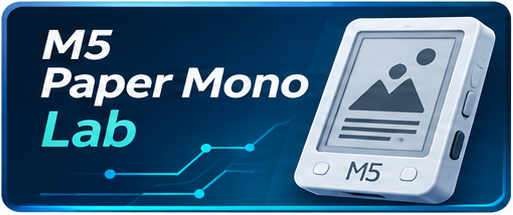
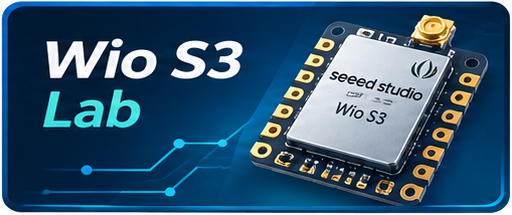
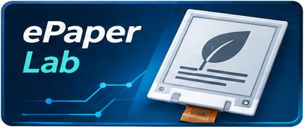
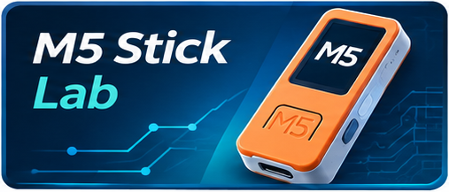

  

## What is ProfeTolocka Labs? - ¿Qué es ProfeTolocka Labs?

<table>
<tr>
<td width="28%" align="center" valign="middle">
  
</td>
<td valign="middle">

**EN:** An open, independent space for exploring, experimenting with and documenting electronics, embedded systems, IoT and related technologies.  
We work with real hardware, share reproducible experiments, explain how technology works and publish code and results as openly as possible.

**ES:** Un espacio abierto e independiente para explorar, experimentar y documentar tecnologías electrónicas, sistemas embebidos, IoT y áreas relacionadas.  
Trabajamos con hardware real, compartimos experimentos reproducibles, explicamos cómo funciona la tecnología y publicamos código y resultados de la forma más abierta posible.

</td>
</tr>
</table>

## Labs / Laboratorios

<table>
<tr>
<td width="50%" valign="top">
  
   
  <strong><a href="https://github.com/profetolocka/M5Stack-PaperMono-Lab">M5 Paper Mono Lab</a></strong>
   
  Hardware evaluation, e-paper, programming and power testing.
   
  Evaluación de hardware, tinta electrónica, programación y pruebas de consumo.
</td>
<td width="50%" valign="top">
  
   
  <strong>Wio S3 Lab</strong>
   
  ESP32-S3 experiments, breakout ideas and embedded development.
   
  Experimentos con ESP32-S3, ideas de breakout y desarrollo embebido.
</td>
</tr>
<tr>
<td width="50%" valign="top">
  
   
  <strong>ePaper Lab</strong>
   
  Displays, libraries, refresh behavior and practical applications.
   
  Pantallas, librerías, comportamiento del refresco y aplicaciones prácticas.
</td>
<td width="50%" valign="top">
  
   
  <strong>M5 Stick Lab</strong>
   
  Compact ESP32 devices, sensors, interfaces and educational experiments.
   
  Dispositivos ESP32 compactos, sensores, interfaces y experimentos educativos.
</td>
</tr>
</table>

## How to participate / Cómo participar

| English | Español |
| :--- | :--- |
| Propose experiments | Proponé experimentos |
| Share measurements and results | Compartí mediciones y resultados |
| Improve documentation | Mejorá la documentación |
| Contribute code | Contribuí con código |

If you want to participate, you can share ideas, suggest tests, report issues or contribute code and documentation.

Si querés participar, podés compartir ideas, proponer pruebas, reportar problemas o contribuir con código y documentación.

## About / Sobre el autor

**Ernesto Tolocka** — Electronics engineer, technical education teacher and embedded systems developer.  
**Ernesto Tolocka** — Ingeniero electrónico, docente de educación técnica y desarrollador de sistemas embebidos.

## Connect / Enlaces

  
  
  
  

  

